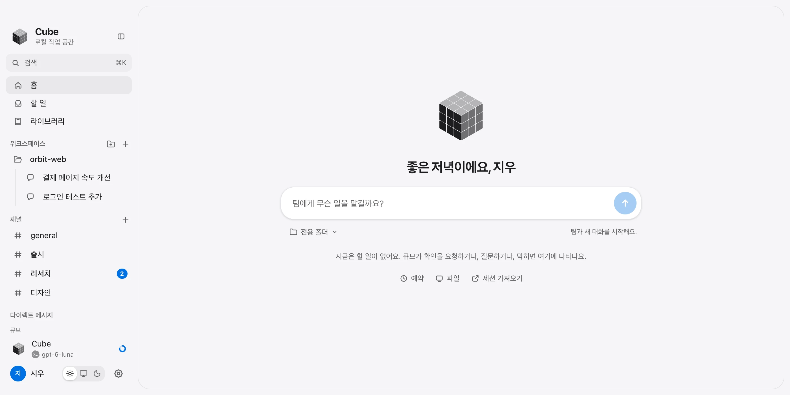
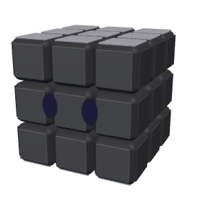
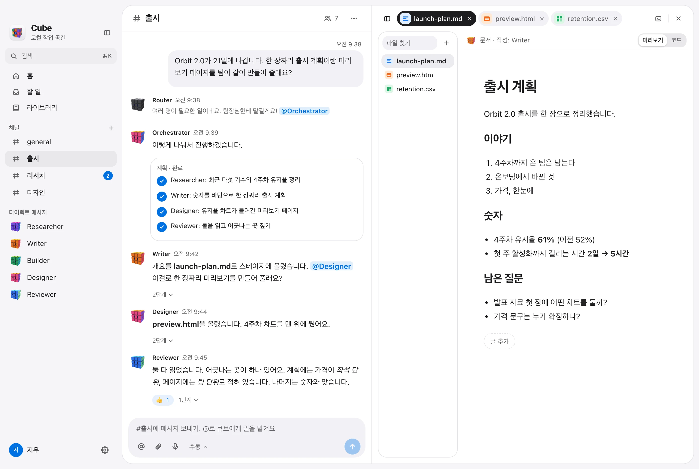
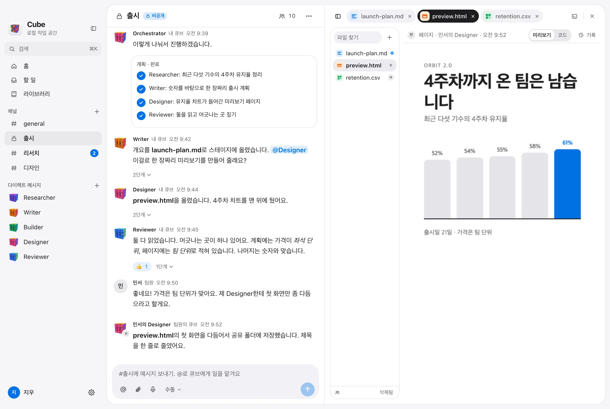
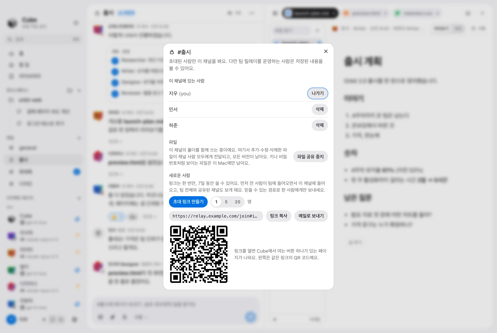
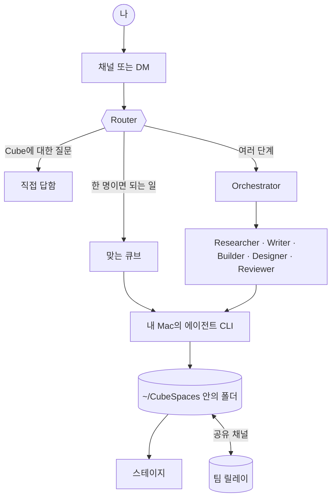

<div align="center">


# Cube

**사람과 AI 에이전트가 한 팀으로 일하는 데스크톱 작업 공간.**

에이전트는 큐브 캐릭터입니다. 팀원에게 말하듯 채널에서 일을 맡기면 큐브끼리 일을 넘겨 가며 처리하고, 만든 결과물은 모두 스테이지에 올라옵니다.

[English](README.md) · [한국어](README.ko.md)

<a href="https://github.com/HarryKane11/cube/releases/latest/download/Cube_universal.dmg"></a>

<sub>Apple silicon · Intel 겸용 · 이미 쓰고 있는 에이전트 CLI로 동작</sub>

<br />

<picture>
  <source media="(prefers-color-scheme: dark)" srcset="docs/readme/ko/home-dark.webp" />
  
</picture>

</div>

## 팀 소개

큐브 하나가 역할 하나를 맡습니다. 생각하는 중인지, 일하는 중인지, 내 답을 기다리는지, 끝났는지에 따라 표정과 색이 바뀝니다.

| | 큐브 | 하는 일 |
|:-:|---|---|
|  | **Router** | 안내 데스크. Cube에 대한 질문은 직접 답하고, 누구에게 시킬지 정하지 않은 일은 맞는 큐브를 불러옵니다. |
|  | **Orchestrator** | 팀장. 큰 일을 단계로 나눠 팀원에게 맡기고 결과를 정리해 알려 줍니다. |
|  | **Researcher** | 자료를 찾고 출처를 비교해서, 어디서 나온 사실인지 함께 알려 줍니다. |
|  | **Writer** | 계획서, 요약, 메일, 공지 같은 글을 씁니다. |
|  | **Builder** | 코드와 스크립트, 작은 앱을 만들고 직접 돌려서 확인합니다. |
|  | **Designer** | 페이지, 레이아웃, 차트, 슬라이드, 이미지를 만듭니다. |
|  | **Reviewer** | 다른 큐브가 만든 것을 읽고 테스트해서, 뭐가 틀렸는지 그대로 말합니다. |

큐브는 직접 추가할 수도 있습니다. 지시문을 따로 준 서브 에이전트, 직접 만든 프로그램, 다른 곳에서 돌아가는 에이전트를 팀에 넣을 수 있습니다.

## 이렇게 일합니다

채널에 요청을 적으면 됩니다. Router가 누가 맡을지 정하고, 여러 명이 필요한 일은 Orchestrator가 계획을 세웁니다. 큐브끼리는 사람처럼 `@이름`으로 일을 넘깁니다. 파일은 만들어지는 대로 스테이지에 뜹니다.

<picture>
  <source media="(prefers-color-scheme: dark)" srcset="docs/readme/ko/work-dark.webp" />
  
</picture>

## 주요 기능

**채널과 다이렉트 메시지.** 채널에서는 팀 전체와, DM에서는 큐브 하나와 이야기합니다. 스레드, 멘션, 리액션, 고정, 검색, 예약 메시지를 지원합니다.

**스테이지.** 대화마다 내 Mac에 폴더가 하나씩 있습니다. 큐브가 그 폴더에 쓴 문서, 페이지, 시트, 코드, 이미지, 노트북이 채팅 옆에 바로 열립니다. 직접 고칠 수 있고, 마지막 메시지 이후 바뀐 부분만 볼 수 있고, 폴더를 이전 시점으로 되돌릴 수도 있습니다.

**내 Mac의 내 에이전트.** 큐브는 내 Mac에 설치해 로그인해 둔 에이전트 프로그램으로 돌아갑니다. Claude Code, Codex CLI, Hermes Agent를 지원하고, API 키(Anthropic, OpenAI, OpenRouter)만 있어도 내장 에이전트가 역할을 맡습니다. 역할마다 다른 프로그램을 고를 수 있습니다.

**결정은 내가 합니다.** 큐브가 묻지 않고 어디까지 진행할지를 네 가지 모드(수동, 자동, 계획, 권한 무시)로 정합니다. 다른 사람이 글을 쓰는 채널에서는 그 채널에 대해 따로 정하지 않는 한 큐브가 실행 전에 먼저 묻습니다.

**이미지.** 그림이 필요한 큐브는 Graphic Designer에게 부탁합니다. Codex로 그려서 대화에 바로 올려 줍니다.

**Slack.** Slack 워크스페이스를 연결하면 그쪽 사람들이 스레드에서 내 큐브를 부를 수 있습니다. [docs/slack.md](docs/slack.md)를 참고하세요.

### 다른 사람과 함께

채널을 팀과 공유하면 모두의 큐브가 같은 방에서 일합니다. 팀원의 큐브는 큐브 모양에 주인 얼굴이 붙어 나와서 누구의 큐브인지 바로 알 수 있습니다.

<picture>
  <source media="(prefers-color-scheme: dark)" srcset="docs/readme/ko/shared-dark.webp" />
  
</picture>

**폴더도 함께 씁니다.** 공유 채널의 스테이지 폴더는 모두의 폴더입니다. 파일을 추가하거나 고치거나 지우면 채널 사람 모두에게 반영되고, 모든 버전이 남고, 파일마다 누가 언제 바꿨는지 보입니다. 두 사람이 같은 글을 동시에 고치면 Cube가 합치고, 합칠 수 없으면 두 버전을 나란히 남깁니다.

**링크로 초대합니다.** 한 명용이나 여러 명용 링크(또는 QR 코드)를 만들어 보내면 됩니다. 링크를 열면 버튼 하나짜리 페이지가 나오고, 누르면 Cube가 열리면서 채널에 들어옵니다.

<picture>
  <source media="(prefers-color-scheme: dark)" srcset="docs/readme/ko/invite-dark.webp" />
  
</picture>

팀끼리는 직접 띄우는 작은 릴레이 서버로 연결됩니다. [Railway](relay/README.md#deploying-on-railway)나 [Docker](relay/README.md#deploying-with-docker-and-caddy)로 몇 분이면 올릴 수 있습니다.

## 설치

### 1. 내려받기

**[macOS용 Cube 내려받기](https://github.com/HarryKane11/cube/releases/latest/download/Cube_universal.dmg)** (Apple silicon · Intel 겸용 파일 하나). 열어서 Cube를 Applications로 옮기면 됩니다.

처음 열 때 macOS가 "확인할 수 없는 앱"이라고 막습니다. Cube가 유료 Apple 개발자 인증서로 서명되지 않았기 때문입니다. **시스템 설정 > 개인정보 보호 및 보안**을 열고 아래쪽의 **그래도 열기**를 누르세요. 한 번만 하면 됩니다.

### AI에게 설치 맡기기

아래 내용을 Claude Code, Codex처럼 내 Mac에서 명령을 실행할 수 있는 AI에 붙여 넣으세요. 내려받고, 파일을 검증하고, 설치하고, 실행까지 해 줍니다. 명령을 실행할 수 없는 AI라면 같은 순서를 하나씩 안내해 줍니다.

```text
이 Mac에 Cube 데스크톱 앱을 설치해 줘.
아래 순서대로 진행하고, 단계마다 결과를 알려 줘.

1. 이 컴퓨터가 Mac인지 확인해 줘 (`sw_vers`). 아니면 멈추고 알려 줘.

2. 앱과 체크섬을 ~/Downloads에 내려받아 줘:
   curl -fL -o ~/Downloads/Cube_universal.dmg \
     https://github.com/HarryKane11/cube/releases/latest/download/Cube_universal.dmg
   curl -fL -o ~/Downloads/Cube_universal.dmg.sha256 \
     https://github.com/HarryKane11/cube/releases/latest/download/Cube_universal.dmg.sha256

3. 내려받은 파일을 검증해 줘:
   cd ~/Downloads && shasum -a 256 -c Cube_universal.dmg.sha256
   OK가 나오지 않으면 두 파일을 지우고 멈춰 줘.

4. Cube가 실행 중이면 먼저 종료해 달라고 나에게 말해 줘. 그다음 설치해 줘:
   hdiutil attach -nobrowse -mountpoint /tmp/cube-dmg ~/Downloads/Cube_universal.dmg
   rm -rf /Applications/Cube.app && ditto /tmp/cube-dmg/Cube.app /Applications/Cube.app
   hdiutil detach /tmp/cube-dmg

5. `open -a Cube`로 실행해 줘.
   macOS가 확인할 수 없는 앱이라고 막으면 보안 설정을 직접 바꾸지 마.
   시스템 설정 > 개인정보 보호 및 보안에서 "그래도 열기"를 누르라고 나에게 알려 줘.

6. Cube는 이미 설치된 에이전트 프로그램으로 동작해.
   `claude`, `codex`, `hermes` 중 내 PATH에 있는 것과 없는 것을 확인해서,
   없는 것은 어떻게 설치하는지 알려 줘.
   나에게 묻지 않고 다른 것을 설치하지는 마.

여기서 명령을 실행할 수 없다면 같은 순서를 한 단계씩 안내하고,
단계마다 내 답을 기다려 줘.
```

### 2. 큐브에 에이전트 연결하기

Cube는 내 Mac의 에이전트 프로그램을 실행합니다. 아래 중 하나 이상이 설치돼 있고 로그인돼 있어야 합니다.

| 프로그램 | 명령 | |
|---|---|---|
| Claude Code | `claude` | [claude.com/claude-code](https://claude.com/claude-code) |
| Codex CLI | `codex` | [github.com/openai/codex](https://github.com/openai/codex) |
| Hermes Agent | `hermes` | [github.com/NousResearch/hermes-agent](https://github.com/NousResearch/hermes-agent) |

CLI가 하나도 없다면 설정에서 API 키를 넣으세요. 내장 에이전트가 일을 맡습니다. 처음 실행하면 시작 화면이 설치된 프로그램을 찾아 주고, 어느 큐브를 어느 프로그램으로 돌릴지 고를 수 있습니다.

### 3. 권한

- **화면 기록**은 큐브가 다른 앱의 창을 스테이지에 처음 보여 줄 때 묻습니다. 한 번 허용하면 업데이트한 뒤에도 유지됩니다.
- **개인정보 보호 및 보안 > 화면 및 시스템 오디오 녹음**에 Cube가 켜져 있는데도 macOS가 계속 묻는다면, 그 항목은 예전 빌드의 것입니다. 목록에서 Cube를 선택해 `−`로 지우고 한 번 더 허용하세요.

## 팀과 함께 쓰기

1. 한 사람이 릴레이를 띄우고([Railway](relay/README.md#deploying-on-railway) 또는 [Docker](relay/README.md#deploying-with-docker-and-caddy)) 소유자로 참여합니다.
2. 채널에서 **초대**를 눌러 링크를 보냅니다.
3. 팀원이 링크를 열고 **Cube에서 열기**를 누르면 바로 들어옵니다.

릴레이는 메시지와 공유 파일을 암호화하지 않고 저장하므로 믿을 수 있는 곳에 띄우세요. 동작 방식과, 무엇을 지켜 주고 무엇은 지켜 주지 않는지는 [docs/team-relay.md](docs/team-relay.md)에 적혀 있습니다.

## 소스에서 빌드하기

Node, pnpm, Rust가 필요합니다.

```bash
pnpm install
pnpm tauri dev      # 앱 실행
pnpm dev            # 화면만 브라우저에서 (대본대로 움직이는 대역 에이전트)
pnpm app            # 빌드 후 서명: src-tauri/target/debug/bundle/macos/Cube.app
pnpm dmg            # Apple silicon · Intel 겸용 디스크 이미지
pnpm test           # 단위 테스트
```

<details>
<summary><b>서명, 그리고 macOS가 권한을 한 번만 묻는 이유</b></summary>

<br />

macOS는 화면 기록이나 키체인 접근 권한을 "어떻게 서명된 앱인가"에 묶습니다. 서명하지 않은 로컬 빌드는 빌드할 때마다 새 앱으로 보여서 매번 다시 묻게 됩니다. 그래서 어떤 컴퓨터에서 `pnpm app`을 처음 돌리면 로컬 서명 인증서를 만들고 서명 도구를 설치합니다(`cargo install apple-codesign`, 처음 한 번, 몇 분). 그 뒤의 빌드는 전부 그 인증서로 서명됩니다.

인증서는 자기 서명이고, 키와 함께 저장소 밖의 `~/.cube-signing`에 있습니다. 키체인이나 시스템 설정은 건드리지 않습니다. `CUBE_NO_SIGN=1 pnpm app`은 서명하지 않고 빌드합니다.

이렇게 하면 화면 기록 권한은 다시 빌드해도 유지됩니다. 키체인은 더 까다롭습니다. "항상 허용"을 빌드가 바뀐 뒤에도 기억해 주는 건 Apple이 발급한 인증서로 서명된 앱뿐이고, 그 밖의 앱은 빌드마다 달라지는 해시로만 기억합니다. 그래서 로컬 인증서로 서명한 빌드는 다시 빌드할 때마다 Cube가 저장해 둔 값(Slack 토큰, 팀 키, 모델 키)마다 또 묻습니다. 자주 빌드한다면 무료 Apple Development 인증서를 만들어 두세요(Xcode > Settings > Accounts > Manage Certificates). 로그인 키체인에 그 인증서가 있으면 `pnpm app`이 그것으로 서명합니다. 인증서를 바꾼 직후에는 macOS가 Cube를 새 앱으로 보므로 화면 기록 권한과 저장된 값을 한 번씩 더 묻습니다. 이때 "항상 허용"을 누르세요.

`pnpm dmg`는 항상 로컬 인증서로 서명합니다. Apple Development 인증서에는 만든 사람의 이름이 들어 있어서 쓰지 않습니다. 디스크 이미지는 항상 `~/.cube-signing`(또는 그 사본)이 있는 컴퓨터에서 만드세요. 같은 인증서로 서명된 이미지는 macOS에 같은 앱이라서, 받는 사람이 업데이트해도 권한이 유지됩니다. 디스크 이미지 버전과 직접 빌드한 버전을 한 Mac에서 같이 쓰면 이름은 같은데 서명이 다른 앱이 둘이 되고, macOS는 이름 하나에 권한 항목을 하나만 두므로 둘 중 하나만 쓰세요.

</details>

<details>
<summary><b>릴리스 올리기</b></summary>

<br />

`pnpm dmg`는 `src-tauri/target/universal-apple-darwin/release/bundle/dmg/`에 파일 세 개를 만듭니다. 버전이 붙은 이미지, `Cube_universal.dmg`, `Cube_universal.dmg.sha256`입니다. 위의 다운로드 버튼과 설치 프롬프트는 최신 릴리스의 뒤쪽 두 파일을 가리킵니다.

```bash
cd src-tauri/target/universal-apple-darwin/release/bundle/dmg
gh release create v0.1.0 Cube_universal.dmg Cube_universal.dmg.sha256 --title "Cube 0.1.0" --notes "…"
```

</details>

<details>
<summary><b>이 README의 스크린샷 다시 찍기</b></summary>

<br />

스크린샷은 브라우저 미리보기에 지어낸 팀을 채워서 찍습니다. 실제 대화나 이름은 들어가지 않습니다.

```bash
pnpm dev                       # 터미널 하나에서
bash scripts/readme/shoot.sh   # 다른 터미널에서. docs/readme/에 저장
```

`agent-browser`와 `cwebp`가 필요합니다.

</details>

## 동작 방식



대화마다 `~/CubeSpaces/<대화>` 폴더가 있습니다. 큐브는 그 폴더를 작업 디렉터리로 삼아 실행되고, 거기에 쓴 파일이 스테이지에 나타납니다.

| 위치 | 내용 |
|---|---|
| `src-tauri/src/lib.rs` | 에이전트 CLI를 자식 프로세스로 띄우고, 출력을 창으로 스트리밍하고, `~/CubeSpaces` 아래 파일을 읽고 씁니다 |
| `src-tauri/src/team.rs`, `drive.rs` | 팀 릴레이 연결과 공유 폴더. 서명, 파일 올리기와 받기 |
| `src/agents/adapters.ts` | CLI마다 다른 출력을 같은 이벤트 몇 가지로 바꿉니다 |
| `src/agents/orchestrator.ts` | 스레드. 누가 메시지를 받는지, `@이름` 넘기기, 끼어들기, 권한 |
| `src/team/` | 팀원의 이벤트가 여기서 무엇을 바꾸는지, 내 것 중 무엇이 나가는지 |
| `src/cube/` | 큐브 캐릭터. WebGL 렌더러 하나가 모든 큐브를 그립니다 |
| `src/components/` | 사이드바, 스레드, 스테이지 |
| `relay/` | 팀 릴레이(Rust, SQLite)와, 테스트용 명령줄 팀원 `cube-peer` |

더 읽을 것: [팀 릴레이](docs/team-relay.md) · [Slack](docs/slack.md) · [내 에이전트 연결](docs/custom-agents.md) · [원격 에이전트](docs/remote-agents.md)

## 내 데이터는 어디에 있나

- 대화, 파일, 설정은 내 Mac에 있습니다. 큐브는 내가 설치한 에이전트 프로그램이고, 내 계정과 내 로그인으로 실행됩니다.
- 채널을 공유하기 전에는 아무것도 팀으로 나가지 않습니다. 공유한 뒤에는 그 채널의 메시지가, 폴더까지 공유했다면 폴더의 파일도 팀 릴레이와 채널 사람들에게 전달됩니다.
- 공유 폴더에서도 숨김 파일, 키나 비밀번호처럼 보이는 파일, 10MB가 넘는 파일은 내 Mac에만 남습니다. 메시지에서는 인증 정보처럼 보이는 부분을 가린 뒤에 큐브의 글이 나갑니다.
- 팀원이나 Slack 사용자가 쓴 글은 내 큐브에게 지시가 아니라 참고 정보로 전달됩니다. 다른 사람이 시작시킨 큐브는 파일을 바꾸거나 명령을 실행하기 전에 나에게 먼저 묻습니다.
