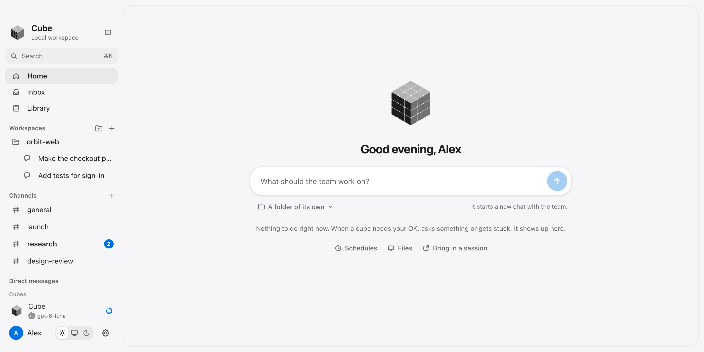
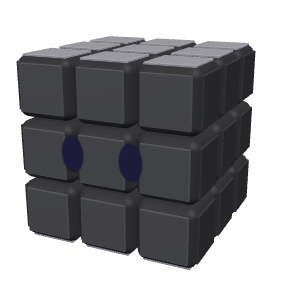
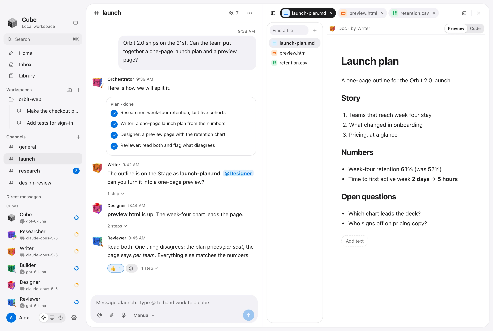
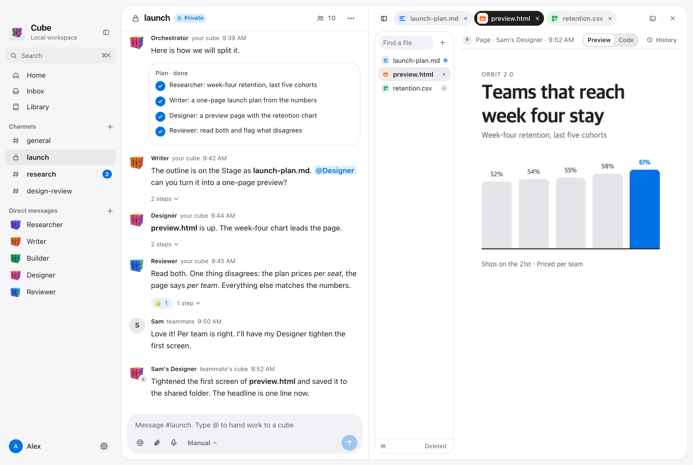
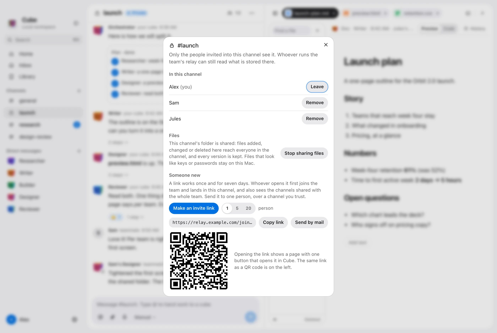
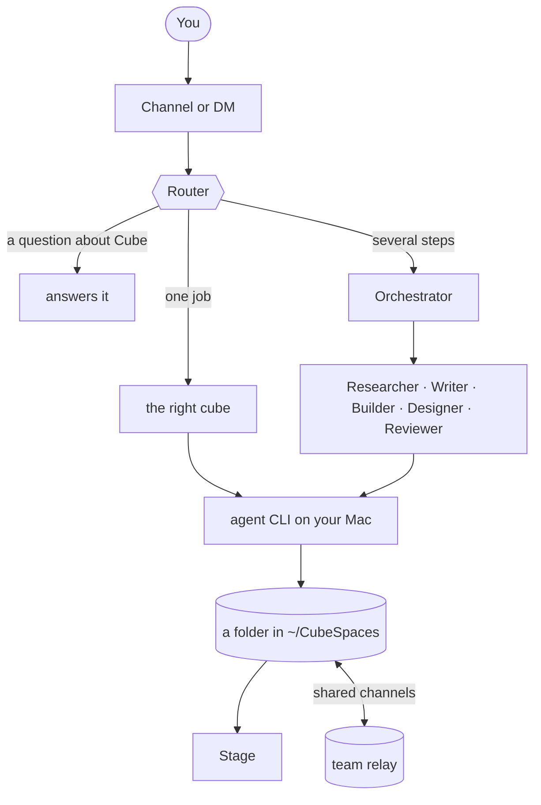

<div align="center">


# Cube

**A desktop workspace where people and AI agents work as one team.**

Your agents are cube characters. You talk to them in channels like you would with teammates, they hand work to each other, and everything they make shows up on a shared Stage.

[English](README.md) · [한국어](README.ko.md)

<a href="https://github.com/HarryKane11/cube/releases/latest/download/Cube_universal.dmg"></a>

<sub>Apple silicon and Intel · runs the agent CLIs you already have</sub>

<br />

<picture>
  <source media="(prefers-color-scheme: dark)" srcset="docs/readme/en/home-dark.webp" />
  
</picture>

</div>

## Meet the team

Every cube is one role with one job. Its face and color follow what it is doing: thinking, working, waiting for you, done.

| | Cube | What it does |
|:-:|---|---|
|  | **Router** | The front desk. Answers questions about Cube itself and, when you name nobody, brings in the cube that should take the job. |
|  | **Orchestrator** | The lead. Splits a bigger job into steps, hands each step to a teammate, and reports back. |
|  | **Researcher** | Looks things up, compares sources, and says where each fact came from. |
|  | **Writer** | Plans, briefs, summaries, emails and posts. |
|  | **Builder** | Code, scripts and small apps, and runs them to make sure they work. |
|  | **Designer** | Pages, layouts, charts, slides and images. |
|  | **Reviewer** | Reads what the others made, tests it, and says plainly what is wrong. |

You can add your own cubes too: a sub-agent with its own instructions, a program you wrote, or an agent running somewhere else.

## See it work

Ask in a channel. The Router decides who should take it, the Orchestrator plans it when it needs several hands, and the cubes pass work along with `@Name` like people do. Files land on the Stage as soon as they exist.

<picture>
  <source media="(prefers-color-scheme: dark)" srcset="docs/readme/en/work-dark.webp" />
  
</picture>

## What you get

**Channels and direct messages.** Talk to the whole team in a channel or to one cube alone. Threads, mentions, reactions, pins, search and schedules work the way you expect.

**The Stage.** Each conversation has a folder on your Mac. Whatever a cube writes there opens beside the chat: documents, pages, sheets, code, images, notebooks. Edit it yourself, read what changed since you last spoke, or rewind the folder to an earlier point.

**Your own agents, on your own machine.** A cube runs on an agent program already installed and signed in on your Mac: Claude Code, Codex CLI or Hermes Agent. With only an API key (Anthropic, OpenAI or OpenRouter) a built-in agent takes the role. Pick a different one for each role.

**You stay in charge.** Four modes decide how far cubes go without asking: Manual, Auto, Plan, Bypass. In a channel that other people write in, cubes ask before they run anything unless you say otherwise for that channel.

**Pictures.** A cube that needs an image asks the Graphic Designer, which draws it with Codex and drops it into the conversation.

**Slack.** Connect a Slack workspace and people there can call your cubes from a thread. See [docs/slack.md](docs/slack.md).

### Work with other people

Share a channel with your team and everyone's cubes work in the same room. A teammate's cube shows up as a cube with its owner's face on the corner, so you always know whose it is.

<picture>
  <source media="(prefers-color-scheme: dark)" srcset="docs/readme/en/shared-dark.webp" />
  
</picture>

**One folder for everyone.** The Stage folder of a shared channel is shared too. Adding, changing and deleting a file reaches everyone in the channel, every version is kept, and each file shows who made it and when. When two people change the same text at once Cube merges it; when it cannot, both versions are kept side by side.

**Invite with a link.** Make a link (or a QR code) for one person or a group. Opening it takes them to a page with one button that opens Cube and puts them in the channel.

<picture>
  <source media="(prefers-color-scheme: dark)" srcset="docs/readme/en/invite-dark.webp" />
  
</picture>

Teams talk through a small relay server that you run yourself. It takes a few minutes on [Railway](relay/README.md#deploying-on-railway) or with [Docker](relay/README.md#deploying-with-docker-and-caddy).

## Install

### 1. Download

**[Download Cube for macOS](https://github.com/HarryKane11/cube/releases/latest/download/Cube_universal.dmg)** (one file for Apple silicon and Intel), open it, and drag Cube into Applications.

The first time you open Cube, macOS says it cannot verify the app, because Cube is not signed with a paid Apple developer certificate. Open **System Settings > Privacy & Security**, scroll down and press **Open Anyway**. You do this once.

### Or let your AI install it

Paste this into Claude Code, Codex, or any assistant that can run commands on your Mac. It downloads Cube, checks the file, installs it and opens it. An assistant that cannot run commands walks you through the same steps instead.

```text
Install the Cube desktop app on this Mac for me.
Work through these steps in order and tell me what happened at each one.

1. Confirm this is a Mac (run `sw_vers`). If it is not, stop and say so.

2. Download the app and its checksum into ~/Downloads:
   curl -fL -o ~/Downloads/Cube_universal.dmg \
     https://github.com/HarryKane11/cube/releases/latest/download/Cube_universal.dmg
   curl -fL -o ~/Downloads/Cube_universal.dmg.sha256 \
     https://github.com/HarryKane11/cube/releases/latest/download/Cube_universal.dmg.sha256

3. Check the download:
   cd ~/Downloads && shasum -a 256 -c Cube_universal.dmg.sha256
   If it does not say OK, delete both files and stop.

4. If Cube is running, ask me to quit it first. Then install it:
   hdiutil attach -nobrowse -mountpoint /tmp/cube-dmg ~/Downloads/Cube_universal.dmg
   rm -rf /Applications/Cube.app && ditto /tmp/cube-dmg/Cube.app /Applications/Cube.app
   hdiutil detach /tmp/cube-dmg

5. Open it with `open -a Cube`.
   If macOS says it cannot verify the app, do not change any security setting yourself.
   Tell me to open System Settings > Privacy & Security and press "Open Anyway".

6. Cube runs on agent programs that are already installed.
   Check which of `claude`, `codex` and `hermes` are on my PATH,
   and tell me which are missing and how to get them.
   Do not install anything else without asking me.

If you cannot run commands here, guide me through the same steps one at a time
and wait for my answer after each.
```

### 2. Give Cube its agents

Cube starts the agent programs on your Mac, so at least one of these should be installed and signed in:

| Program | Command | |
|---|---|---|
| Claude Code | `claude` | [claude.com/claude-code](https://claude.com/claude-code) |
| Codex CLI | `codex` | [github.com/openai/codex](https://github.com/openai/codex) |
| Hermes Agent | `hermes` | [github.com/NousResearch/hermes-agent](https://github.com/NousResearch/hermes-agent) |

No CLI? Add an API key in Settings and the built-in agent does the work. The welcome screen finds what you have and lets you choose which program powers which cube.

### 3. Permissions

- **Screen Recording** is asked for the first time a cube shows you another app's window on the Stage. Allow it once; Cube keeps it across updates.
- If macOS keeps asking although Cube is switched on under **Privacy & Security > Screen & System Audio Recording**, that entry belongs to an older build. Select Cube there, remove it with `−`, and allow it once more.

## Bring your team

1. One person runs the relay ([Railway](relay/README.md#deploying-on-railway) or [Docker](relay/README.md#deploying-with-docker-and-caddy)) and joins as the owner.
2. In a channel, press **Invite** and send the link.
3. Teammates open the link, press **Open in Cube**, and they are in.

The relay stores messages and shared files as they are, so run it somewhere you trust. How it works, and what it does and does not protect, is written down in [docs/team-relay.md](docs/team-relay.md).

## Build from source

Needs Node, pnpm and Rust.

```bash
pnpm install
pnpm tauri dev      # run the app
pnpm dev            # only the screens, in a browser, with scripted stand-in agents
pnpm app            # build and sign src-tauri/target/debug/bundle/macos/Cube.app
pnpm dmg            # build the disk image for both kinds of Mac
pnpm test           # unit tests
```

<details>
<summary><b>Signing, and why macOS asks for a permission only once</b></summary>

<br />

macOS ties permissions (Screen Recording, Keychain access) to how an app is signed. An unsigned local build looks like a new app after every rebuild, and macOS would ask again each time. So the first `pnpm app` on a computer makes a local signing identity and installs the signing tool (`cargo install apple-codesign`, a few minutes, once), and every build after that is signed with it.

The identity is a self-signed certificate and key in `~/.cube-signing`, outside the repository. No keychain and no system setting is touched. `CUBE_NO_SIGN=1 pnpm app` leaves a build unsigned.

That keeps Screen Recording granted across rebuilds. The Keychain is stricter: it remembers "Always Allow" across rebuilds only for an app signed with a certificate Apple issued, and knows any other app by each build's own hash. With the local identity, every rebuild is asked again for each secret Cube saved (Slack tokens, the team key, model keys). If you rebuild often, make a free Apple Development certificate (Xcode > Settings > Accounts > Manage Certificates): `pnpm app` signs with it whenever the login keychain has one. The switch makes Cube a new app to macOS once, so Screen Recording and each saved secret are asked for one more time; choose Always Allow.

`pnpm dmg` always signs the disk image's app with the local identity, never with an Apple Development certificate, which carries its owner's name. Make every disk image on the computer that holds `~/.cube-signing` (or a copy of it): images signed with the same identity are the same app to macOS, so people keep their permissions across updates. Someone who uses both a disk image and their own build from source has two differently signed apps under one name, and macOS keeps one permission entry per name, so use one or the other.

</details>

<details>
<summary><b>Publishing a release</b></summary>

<br />

`pnpm dmg` writes three files to `src-tauri/target/universal-apple-darwin/release/bundle/dmg/`: the versioned image, `Cube_universal.dmg`, and `Cube_universal.dmg.sha256`. The download button and the install prompt above point at the last two on the latest release:

```bash
cd src-tauri/target/universal-apple-darwin/release/bundle/dmg
gh release create v0.1.0 Cube_universal.dmg Cube_universal.dmg.sha256 --title "Cube 0.1.0" --notes "…"
```

</details>

<details>
<summary><b>Retaking the pictures in this README</b></summary>

<br />

The screenshots come from the browser preview filled with a made-up team, so nothing real is in them.

```bash
pnpm dev                       # in one terminal
bash scripts/readme/shoot.sh   # in another; writes docs/readme/
```

Needs `agent-browser` and `cwebp`.

</details>

## How it works



Each conversation is a folder at `~/CubeSpaces/<conversation>`. Cubes run with that folder as their working directory, and any file they write there appears on the Stage.

| Where | What |
|---|---|
| `src-tauri/src/lib.rs` | Starts agent CLIs as child processes, streams their output to the window, reads and writes files under `~/CubeSpaces` |
| `src-tauri/src/team.rs`, `drive.rs` | The connection to the team relay and the shared folder: signing, sending and fetching files |
| `src/agents/adapters.ts` | Turns each CLI's output into the same small set of events |
| `src/agents/orchestrator.ts` | The thread: who gets a message, `@Name` handoffs, stepping in, permissions |
| `src/team/` | What teammates' events change here, and what of yours goes out |
| `src/cube/` | The cube character. One shared WebGL renderer draws every cube |
| `src/components/` | Sidebar, thread, Stage |
| `relay/` | The team relay (Rust, SQLite) and `cube-peer`, a command-line teammate for testing |

More to read: [team relay](docs/team-relay.md) · [Slack](docs/slack.md) · [your own agent](docs/custom-agents.md) · [remote agents](docs/remote-agents.md)

## Where your data lives

- Conversations, files and settings stay on your Mac. Cubes are the agent programs you installed, running under your account, with your sign-in to each.
- Nothing goes to a team until you share a channel. From then on that channel's messages, and its folder if you share it, go to your team's relay and to the people in the channel.
- In a shared folder, hidden files, files that look like keys or passwords, and anything over 10 MB stay on your Mac. In messages, what looks like a credential is hidden before a cube's words go out.
- What teammates and people in Slack write reaches your cubes as information, not as instructions. A cube that someone else started asks you before it changes a file or runs a command.
